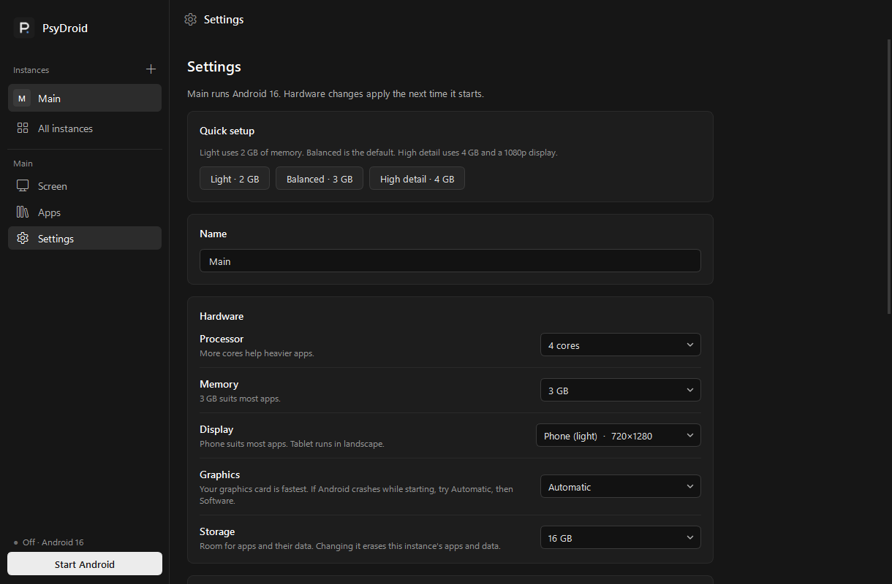

# PsyDroid

Run Android apps and browse the web on Windows. PsyDroid is a native desktop app that sets up Google's official Android Emulator with Android 16 and Google Play, and gives it a plain, quiet window: no ads, no account, no telemetry, and no gaming extras.



## Get started

1. Download the `PsyDroid-<version>-windows-x64.zip` file from the [latest release](https://github.com/UndoingSkyy/psydroid/releases/latest), extract it anywhere, and open `PsyDroid\PsyDroid.exe`. Keep the `_internal` folder beside it. The app isn't code-signed, so Windows may show a SmartScreen warning: choose **More info**, then **Run anyway**.
2. Choose **Download and install**. PsyDroid fetches Google's emulator, adb and the Android 16 image (about 1.9 GB, once) and shows the Android SDK License first.
3. Press **Start Android**. Sign in to Google Play inside Android, or drop APK files onto the screen.

You need Windows 10 or 11 (64-bit), Windows Hypervisor Platform turned on, current graphics drivers, about 4 GB of free disk space plus room for each instance, and ideally 8 GB of RAM or more.

## What it does

- **Several Androids at once**, each with its own apps, accounts and settings. Create, clone, back up to one file, restore, open any of them in its own window, or tile them side by side.
- **Ad-free web**: one click installs Firefox with uBlock Origin inside Android. **Block ads** filters ad networks inside apps through AdGuard DNS.
- **Apps**: install `.apk`, `.apks` and `.xapk` files by dropping them on the screen, see what's installed, uninstall, or put a shortcut to an app on your desktop.
- **Everyday tools**: screenshots, screen recording, a clipboard shared with Windows, file import and export, Ctrl+scroll to zoom, rotate, volume, GPS location and your webcam as Android's camera.
- **Sensible defaults**: a 720 x 1280 display, 3 GB of memory on an 8 GB PC, up to 4 CPU cores and your graphics card for drawing. Light, Balanced and High detail choices in each instance's Settings, and presets you can save for new instances.
- **Stays out of the way**: keep running in the tray, start with Windows, a shortcut that hides every window, mute, and stay on top.
- **Careful with your data**: downloads are checksum-verified and resume safely, archives are unpacked in a staging folder, settings are written atomically, and a stalled first boot is stopped without erasing anything.

Everything PsyDroid stores lives in `%LOCALAPPDATA%\PsyDroid`, and it can be moved to another drive from All instances.

To check the download, compare `Get-FileHash` of the ZIP in PowerShell with `SHA256SUMS.txt` from the same release.

## Build

To build it yourself instead, you need Python 3.13 or 3.14 (64-bit) and Git. Dependencies are pinned.

```powershell
.\build.ps1
```

This creates a virtual environment, runs the tests, builds the portable app into `dist\PsyDroid`, and writes a ZIP plus `dist\SHA256SUMS.txt`. Run `.\build.ps1 -Installer` with Inno Setup 6 installed to also build a setup wizard.

Run from source and run the tests:

```powershell
.venv\Scripts\pythonw.exe PsyDroid.pyw
.venv\Scripts\python.exe -m unittest discover -s tests -v
```

Set `PSYDROID_HOME` to a test folder to keep development data separate from your real instances. The tests cover download corruption and resume, unsafe archives, extraction rollback, launch and shutdown failures, the cold-boot timeout, interrupted settings writes and UI navigation. They mock the Android runtime, so they don't prove Android boots.

## Troubleshooting

- Crash details: `%LOCALAPPDATA%\PsyDroid\data\crash.log`
- Device logs: `%LOCALAPPDATA%\PsyDroid\data\logs`, also reachable from a stopped device's screen
- If Android crashes while starting, set Graphics to Software in the instance's Settings. It is much slower, so switch back to Graphics card once your graphics driver is updated.
- Deleting an instance's folder erases its apps and data, so avoid it as a troubleshooting step.

## License

MIT. See [LICENSE](LICENSE). Third-party components and their terms are listed in [THIRD_PARTY_NOTICES.md](THIRD_PARTY_NOTICES.md). Google's emulator, adb and the Google Play system image are downloaded separately under Google's own terms and are not part of this repository. PsyDroid is not affiliated with Google.
